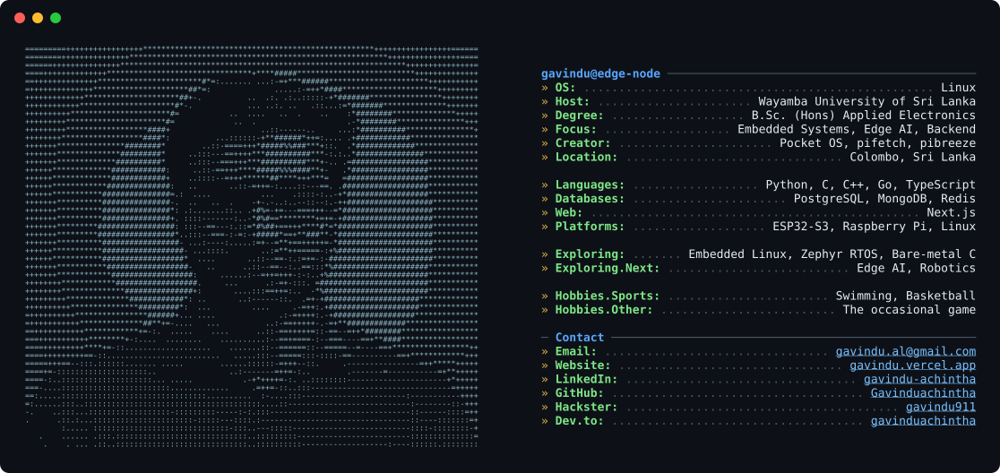

<pre>
 ██████╗  █████╗ ██╗   ██╗██╗███╗   ██╗██████╗ ██╗   ██╗
██╔════╝ ██╔══██╗██║   ██║██║████╗  ██║██╔══██╗██║   ██║
██║  ███╗███████║██║   ██║██║██╔██╗ ██║██║  ██║██║   ██║
██║   ██║██╔══██║╚██╗ ██╔╝██║██║╚██╗██║██║  ██║██║   ██║
╚██████╔╝██║  ██║ ╚████╔╝ ██║██║ ╚████║██████╔╝╚██████╔╝
 ╚═════╝ ╚═╝  ╚═╝  ╚═══╝  ╚═╝╚═╝  ╚═══╝╚═════╝  ╚═════╝
</pre>

<b>EMBEDDED SYSTEMS  ·  EDGE AI  ·  APPLIED ELECTRONICS</b>

 

  

<pre>

  

</pre>

## `01` — Featured projects

<table>
  <tr>
    <td colspan="2" valign="top">
      <h3>📟 Pocket OS</h3>
      <!-- TODO: add the Pocket OS repo link -->
      
A custom operating system for the ESP32-S3 with a built-in display. A handy pocket embedded tool, in the spirit of M5Stack, for analysing WiFi and Bluetooth on the go.

      <strong>ESP32-S3 · Embedded OS · WiFi · Bluetooth · Display</strong>
    </td>
  </tr>
  <tr>
    <td width="50%" valign="top">
      <h3>🦉 <a href="https://github.com/Gavinduachintha/WildLife_AI">WildLife AI</a></h3>
      
Edge-AI wildlife monitoring that detects potential threats and sends GPS-tagged alerts over LoRa, designed to operate without internet connectivity.

      <strong>Raspberry Pi 5 · YOLOv8 · Python · LoRa · GPS</strong>
    </td>
    <td width="50%" valign="top">
      <h3>🚗 <a href="https://github.com/Gavinduachintha/Mindful-Drive-Pro">Mindful Drive Pro</a></h3>
      
An edge-AI driver monitoring project using computer vision to identify signs of drowsiness.

      <strong>Arduino UNO Q · Edge Impulse · YOLO · Computer Vision</strong>
    </td>
  </tr>
  <tr>
    <td width="50%" valign="top">
      <h3><a href="https://github.com/Gavinduachintha/Pifetch">🍓 pifetch</a></h3>
      
A dependency-free neofetch alternative for the Raspberry Pi 5 that reports more system detail than neofetch.

      <strong>Python · Raspberry Pi 5 · CLI · Zero dependencies</strong>
    </td>
    <td width="50%" valign="top">
      <h3><a href="https://github.com/Gavinduachintha/Pibreeze">🌬️ pibreeze</a></h3>
      
A custom fan speed controller for the Raspberry Pi 5, keeping it cool and quiet.

      <strong>Python · Raspberry Pi 5 · Fan control</strong>
    </td>
  </tr>
  <tr>
    <td width="50%" valign="top">
      <h3>🌿 <a href="https://github.com/Gavinduachintha/Trailside">Trailside</a></h3>
      
An offline AI-powered nature guide using local language models to support field-based exploration without cloud dependency.

      <strong>Python · Streamlit · Ollama · Gemma</strong>
    </td>
    <td width="50%" valign="top">
      <h3>🧩 <a href="https://github.com/Gavinduachintha/Neo_Stick">Neo Stick</a></h3>
      <!-- TODO: name the MCU, what it does, and one notable feature -->
      
An embedded hardware and software project exploring compact microcontroller-based systems.

      <strong>Embedded development · Microcontrollers · Electronics</strong>
    </td>
  </tr>
</table>

## `02` — GitHub stats

 

### Let's build something meaningful.

Colombo, Sri Lanka

