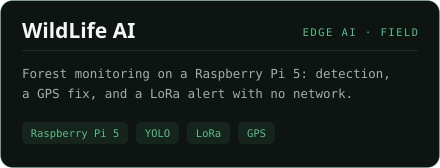
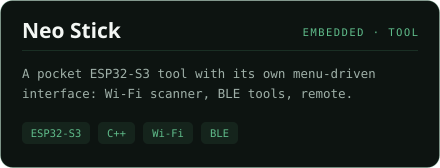
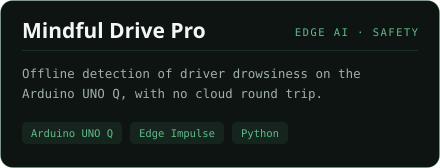
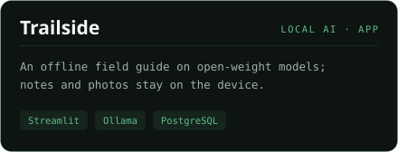

<div align="center">



<a href="https://gavindu.vercel.app/"></a>
<a href="https://www.linkedin.com/in/gavindu-achintha"></a>
<a href="mailto:gavindu.al@gmail.com"></a>
<a href="https://www.hackster.io/gavindu911"></a>
<a href="https://dev.to/gavinduachintha"></a>

</div>

```console
gavindu@edge-node:~$ whoami
Applied Electronics undergraduate at AarchLabs, in Colombo, Sri Lanka.
I work where the board meets the service: microcontrollers, on-device
vision, robotics, and the backends that keep those pieces talking.

gavindu@edge-node:~$ cat interests.txt
swimming · basketball · the occasional game
```

<div align="center"><h3>Focus</h3></div>

<table>
<tr>
<td width="33%" valign="top">

**Embedded & Edge**


Devices that keep working where a reliable network cannot be assumed.

</td>
<td width="33%" valign="top">

**Applied Intelligence**


Vision and models that run on the device rather than in someone else's cloud.

</td>
<td width="33%" valign="top">

**Software**


The interfaces and services that make the hardware useful.

</td>
</tr>
</table>

<div align="center"><h3>Selected work</h3></div>

<p align="center">
  <a href="https://github.com/Gavinduachintha/WildLife_AI"></a>
  <a href="https://github.com/Gavinduachintha/Neo_Stick"></a>
  <a href="https://github.com/Gavinduachintha/Mindful-Drive-Pro"></a>
  <a href="https://github.com/Gavinduachintha/Trailside"></a>
</p>

<div align="center">

<sub>WildLife AI was funded by Avnet and featured by Seeed Studio · more on <a href="https://www.hackster.io/gavindu911">Hackster</a></sub>

<br/><br/>

**Open to work that joins hardware and software, from a field node to the service behind it.**

<a href="https://gavindu.vercel.app/">gavindu.vercel.app</a> · <a href="mailto:gavindu.al@gmail.com">gavindu.al@gmail.com</a>

</div>
